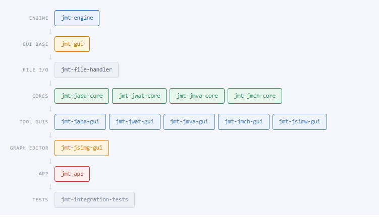
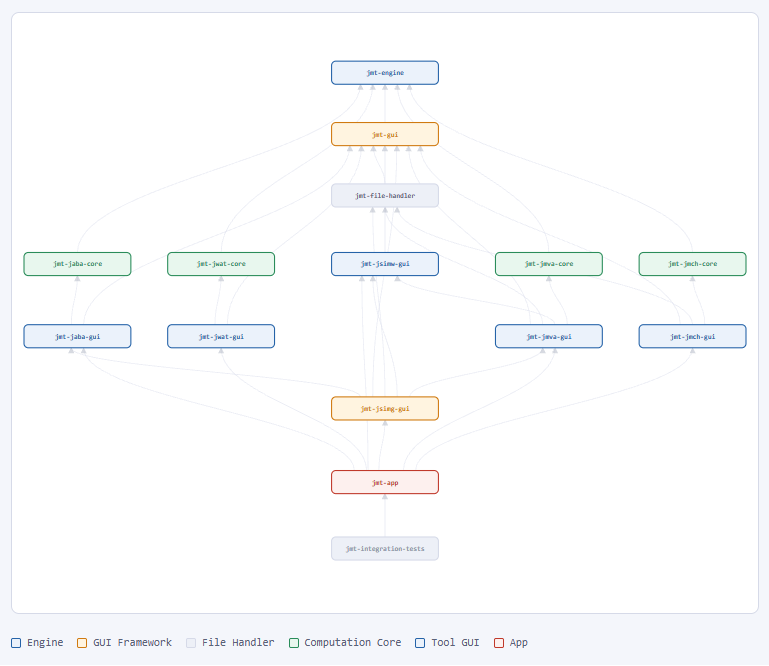
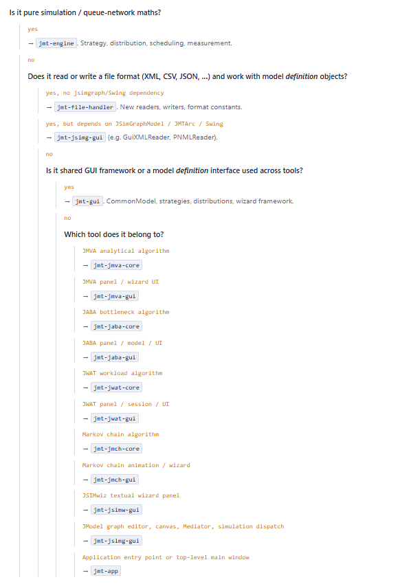

# Contributing to JMT

Thanks for your interest in contributing to Java Modelling Tools (JMT)! This document covers how to propose changes, the expected workflow, the conventions used in this repository, and an overview of the architecture.

Java Modelling Tools (JMT) is a Java Swing suite for performance evaluation and capacity planning of queueing network models. It bundles six tools:
*   **JSIMwiz**: wizard-driven discrete-event simulator.
*   **JSIMgraph**: graphical (canvas) editor/front-end for the same simulation engine.
*   **JMVA**: exact/approximate analytical MVA solver for product-form networks.
*   **JMCH**: single-station Markov chain simulator/visualizer.
*   **JABA**: bottleneck identification via convex hull algorithms.
*   **JWAT**: workload characterization / clustering tool for log data (e.g. Apache logs).

## Ways to Contribute

*   **Report a bug** using the [bug report template](.github/ISSUE_TEMPLATE/bug_report.md).
*   **Propose an enhancement** using the [feature request template](.github/ISSUE_TEMPLATE/feature_request.md).
*   **Propose a BSc/MSc thesis project** using the [thesis proposal template](.github/ISSUE_TEMPLATE/thesis_proposal.md).
*   **Submit a pull request** fixing a bug, implementing an approved feature, or improving documentation/tests.

For anything non-trivial (new modeling capabilities, schema changes, or anything touching both `jmt.commandline` and `jmt.jmva`), please open an issue first to discuss the approach before writing code. Please refer to the [Architecture](#architecture) section below for an overview of how the pieces fit together. 

---

## Getting Started: Build & Test Commands

1.  Fork the repository and clone your fork.
2.  Requires **Maven 3.6.3+** and exactly **Java 8** (JDK 1.8). The project must be compiled with Java 1.8 specifically due to `jmt-jsimg-gui/src/main/java/jsimgraph/JGraphMod/JmtJGraph.java`. This is because the class is heavily dependent on legacy third-party graphical libraries—specifically `org.freehep` (`VectorGraphics` and `ExportDialog`) and `org.jgraph` (specifically JGraph version 5.8), which date back to 2006. These older packages rely on legacy Java architecture that precedes the Java 9 module system and the strict encapsulation of internal JDK APIs. Consequently, components like the FreeHEP export dialog cannot be successfully constructed or compiled on newer JDKs.
3.  **Build:** 
    *   `mvn package` - compile and build `JMT-singlejar-<version>.jar` under `target/`.
    *   `mvn install` / `mvn deploy` - also builds the IzPack installer (`JMT-installer-<version>.jar`).
4.  **Run the test suite:** 
    *   `mvn test` - run the JUnit suite. **GUI tests are excluded by default** (see `<excludes>` in the `full` profile of `pom.xml`): `JabaGuiTest`, `JmchGuiTest`, `JmvaGuiTest`, `JSIMgraphGuiTest`, `JSIMwizGuiTest`, `JwatGuiTest`, `MainGuiTest`, and several JMVA batch/data-collection helper classes. These are long-running/FEST-Swing UI tests or data-generation scripts, not part of the regular test loop.
    *   `mvn test -Dtest=ClassName` - run a single test class (standard Surefire).
    *   `mvn test -Dtest=ClassName#methodName` - run a single test method.
    *   `mvn test -Dtest=IntegrationTest -pl jmt-integration-tests -am` (or `mvn test -pl jmt-integration-tests -am`) - run all headless integration tests across JSIM, JMVA, JSIMwiz, and JABA with JaCoCo attached. See [Integration Tests Guide](docs/integration_tests.md).
    *   JaCoCo is wired into `mvn test` automatically (`prepare-agent` + `report` at the `test` phase); report lands at `target/site/jacoco/jacoco.xml`. For per-model coverage analysis and test suite minimization, see the [Coverage Optimization Tool](docs/coverage_greedy_set_cover.md).
5.  **Launch a specific tool from source:** 
    *   `mvn -Pfull -DskipTests -Dexec.mainClass=jmt.gui.common.startScreen.GraphStartScreen exec:java`
6.  **Debug a running instance:** 
    *   The VS Code task "Maven: exec:java debug GraphStartScreen (8000)" launches the suite with a JDWP agent on port 8000 (`MAVEN_OPTS='-agentlib:jdwp=...' mvn -Pfull -DskipTests -Dexec.mainClass=jmt.gui.common.startScreen.GraphStartScreen exec:java`); attach with the "Attach to Maven exec:java (8000)" launch config.
7.  **Headless/CLI mode (no GUI):** 
    *   `java -cp <jar> jmt.commandline.Jmt [mva|sim|jsimw|jsimg] <modelfile.xml> [-seed N] [-maxtime N]` drives `solvers.dispatchers.SolverDispatcher` or `simDispatcher.DispatcherJSIMschema` directly against a model XML file. See the [Headless CLI Reference Guide](docs/cli_reference.md) for complete options and usage examples.
8.  **Legacy packaging:** 
    *   There's a separate `jmva` Maven profile (`-Pjmva -Dmode=jmva`) that builds a JMVA-only jar targeting Java 1.7 with a different main class (`jmt.jmva.JMVAWizard`) - a legacy/standalone packaging path, distinct from the default `full` profile.

---

## Development Workflow

1.  Create a topic branch off `main`, named descriptively (e.g. `fix/jsim-fork-join-deadlock`, `feature/priority-routing-strategy`).
2.  Keep changes focused - one logical change per pull request. Unrelated cleanups make review harder and should be a separate PR.
3.  Match the existing code style in the file/package you're editing (indentation, brace style, naming). There is no enforced formatter/linter configuration in this repo, so consistency with surrounding code is the standard to follow.
4.  Add or update tests for any behavior change:
    *   Unit tests under `src/test/java`.
    *   For simulation/analytical solver correctness fixes, add new models directly to the integration test suite (`jmt-integration-tests/src/test/resources/jmt/integration/input/`). See [Adding New Test Models & Oracles](docs/integration_tests.md#9-adding-new-test-models--oracles) for the end-to-end workflow on creating baseline oracles and running stability checks. 
    *   If your change affects the model XML format, keep `src/main/resources/jmt/common/xml` schemas and any XSLT converters in sync.
    *   Check whether the `jmt.integration` suite needs new sample models.
5.  Run `mvn test` locally before opening a PR. GUI tests (`*GuiTest`) are excluded from the default run - if your change affects GUI behavior, note in the PR description how you tested it (running the excluded GUI tests locally, or manual testing steps).
6.  Update documentation as needed - this includes user-facing docs (`manuals/`, in-app help) as well as updating this contributing guide if you change the architecture or build/test workflow it describes.

---

## Architecture

### XML is the integration layer between GUI and engines

There is no shared in-memory model between the GUI processes and the solver engines - everything crosses that boundary as XML validated against schemas in `src/main/resources/jmt/common/xml/` (loaded via `jmt.common.xml.XSDSchemaLoader`):

*   `SIMmodeldefinition.xsd` / `SIMmodeloutput.xsd` - JSIM model + simulation results.
*   `JMTmodel.xsd` - JMVA model.
*   `JModelGUI.xsd` - JSIMgraph canvas layout.
*   `Archive.xsd`, `Results.xsd` - combined project archives / GUI-side results.
*   `MVAtoSIM.xslt`, `SIMtoMVA.xslt`, `OUTtoMVA.xslt` - XSLT converters between the JMVA and JSIM model formats.

`jmt.gui.common.xml` (`XMLReader`/`XMLWriter`/`GuiXMLReader`/`GuiXMLWriter`/`XMLArchiver`) does the actual (de)serialization of the shared GUI model to/from these formats. Because a model is just an XML document, any GUI (wizard or graphical) can produce a file that any engine - or the headless `jmt.commandline.Jmt` - can consume, and vice versa for results. When changing model semantics, the schema, the reader/writer, and the engine-side transformer usually all need to move together.

### Two independent solver engines

*   **`jmt.commandline`** - the discrete-event simulator. `simEngine` (`SimSystem`, `Simulation`, `SimEvent`, `EventQueue`) is a generic event-scheduling kernel; `QueueNet` supplies the domain model (`NetSystem`, `NetNode`, `QueueNetwork`, `JobClass`/`Job`, `NodeSection`); `NodeSections` implements concrete station behaviors (`Queue`, `Server`, `Fork`, `Join`, `Router`, `Delay`, `Storage`, `Cache`, ...); `NetStrategies` supplies pluggable policies (routing, service, forking, joining, queue put/get, vacation, caching). `simDispatcher.DispatcherJSIMschema` is the bridge that reads a `SIMmodeldefinition.xsd` file, builds and runs the network, and writes results back per `SIMmodeloutput.xsd`.
*   **`jmt.jmva`** - the analytical MVA solver (`jmva/analytical/solvers`, `jmva/engine`), entirely separate machinery for exact/approximate product-form analysis. It does reuse some low-level `jmt.commandline` utilities (math, random engine, logging) and, in `DispatcherJMVAschema`, can invoke the simulation engine directly for hybrid solves - but the two are otherwise parallel systems connected only through shared XML formats and XSLT conversion, not shared runtime objects.

Don't assume a fix in one engine applies to the other, and don't assume `jmt.commandline` changes are visible to `jmt.jmva` (the dependency mostly runs one direction).

### GUI structure

`jmt.gui.common` is the shared GUI framework - model classes (`definitions/`), probability distributions, strategy UI mirroring `jmt.engine.NetStrategies`, the XML layer described above, shared panels/editors, and `startScreen/` (the suite launcher). **JSIMwiz** and **JSIMgraph** both build heavily on `jmt.gui.common`, editing the same underlying model through a wizard vs. a graphical-canvas front-end respectively. `jmva`, `jaba`, `jwat`, and `table` are largely self-contained per-tool GUI packages under `jmt.gui`.

### Entry points

`jmt.gui.common.startScreen.GraphStartScreen` (the default `mainClass` in `pom.xml`) is the suite launcher screen; clicking a tool icon instantiates that tool's own main class: `JSIMWizMain`, `JSIMGraphMain`, `JMVAWizard`, `JabaWizard`, `MainJwatWizard` (jwat), `MainWizard` (jmch). Each of these also has a standalone `main()`. `jmt.commandline.Jmt` is the headless entry point for running solves from scripts/CI without any GUI involved.

### Integration Testing (`jmt.integration`)

`jmt-integration-tests/src/test/java/jmt/integration/IntegrationTest.java` is a parameterized JUnit 5 integration suite (distinct from the regular unit tests) that runs every model file under `src/test/resources/jmt/integration/input/{jsim,jsimw,jmva,jaba}` through the corresponding engine, tracks per-line bytecode coverage via `jmt.integration.CoverageTracker`, and writes `*_coverage.csv` / `timeouts.csv` reports to `target/jmt/integration/output/`. It requires `target/classes` to already exist (`mvn compile` first) and isolates coverage to core computation modules (`jmt-engine`, `jmt-jmva-core`, `jmt-jaba-core`, `jmt-jwat-core`, `jmt-jmch-core`). For full execution commands, IntelliJ setup, and oracle stability check details, see the [JMT Integration Testing Guide](docs/integration_tests.md).

---

## Module Reference

JMT is organized into a layered 16-module Maven project. Modules belong to explicit dependency layers; modules in layer *N* may only import from layers below them.



### Layer 0: Engine
*   **`jmt-engine`**: Pure simulation engine. Owns the queue-network runtime (`QueueNet`, `NodeSection`, `NetNode`), scheduling strategies (FCFS, PS, LCFS, SJF, etc.), random distributions, parametric analysis engine, XML schema constants (`XMLConstantNames`, `XMLResultsConstants`), schema loader (`XSDSchemaLoader`), XML utilities (`XMLUtils`), format transformer (`ModelTransformer`), CSV logging, and the engine-side simulation dispatcher (`DispatcherJSIMschema`). Contains zero GUI dependencies.

### Layer 1: GUI Framework
*   **`jmt-gui`**: Shared GUI framework and model definition interfaces. Owns `CommonModel`, `SimulationDefinition`, `ClassDefinition`, `StationDefinition`, all strategy interfaces (routing, fork, join, service, semaphore), distribution wrappers, the `ModelLoader` base class, `Defaults`, `CommonConstants`, `JMTImageLoader`, and the Swing wizard framework (`jmt.framework.gui.*`). Depends on `jmt-engine`.

### Layer 2: File Serialization
*   **`jmt-file-handler`**: Centralized model serialization layer decoupled from UI components. Owns `XMLWriter`, `XMLReader`, `XMLResultsWriter`, `XMLResultsReader`, and schema constant interfaces (`GuiXMLConstants`, `PNMLConstants`). Depends on `jmt-gui` and transitively on `jmt-engine`.

*   **`jmt-legacy-xml`**: Exports model XML (`.jsimg`, `.jsimw`, simulation input) in the format of earlier releases (up to 1.4.0). The refactoring renamed Java packages, and the XML stores them in `classPath` attributes, so old releases cannot read files saved by current code; the schemas themselves are unchanged. JDK-only. CLI: `java -cp jmt-legacy-xml.jar legacyxml.LegacyXmlExporter <in> <out> [1.4.0|current]`. When you rename a package whose classes appear in saved XML, update the root lists in `LegacyXmlExporter`. See the [Legacy XML Compatibility Guide](docs/legacy_xml_converter.md) for full details.

### Layer 3: Analytical & Computation Cores
*   **`jmt-jmva-core`**: JMVA analytical solver. Owns all MVA algorithms (exact, approximate, AMVA, CoMoM, Tree MVA, Tree Convolution, Monte Carlo, RECAL), `analytical.ExactModel`, `QNModel`, `PopulationVector`, `BigRational`, and the CLI solver entry point.
*   **`jmt-jaba-core`**: JABA (Bottleneck Analysis) pure computation. Owns convex-hull algorithms, saturation analysis, and the geometric calculation engine.
*   **`jmt-jwat-core`**: JWAT (Workload Analysis Tool) computation. Owns clustering algorithms (K-Means, Fuzzy K-Means), workload characterisation, traffic models, and format readers/writers (`FormatFileReader/Writer`).
*   **`jmt-jmch-core`**: JMCH (Markov Chain) computation. Owns continuous and discrete Markov chain solvers, as well as steady-state and transient analysis.

### Layer 4: Tool-Specific GUIs
*   **`jmt-jmva-gui`**: JMVA wizard panels (Classes, Stations, ServiceDemands, Graph, WhatIf, etc.), the JMVA↔JSIM bridge dispatcher (`DispatcherJMVAschema`), and the `JMVAController` interface.
*   **`jmt-jaba-gui`**: JABA panels, `JabaModel`, graphical results panels (convex hull, saturation sectors), and the `JabaController` interface.
*   **`jmt-jwat-gui`**: JWAT wizard, workload data loaders, clustering panels, and ZIP+XML session storage.
*   **`jmt-jmch-gui`**: JMCH animation wizard, queue animation station components, and Markov chain visualization (`jmt.jmarkov.Graphics`).
*   **`jmt-jsimw-gui`**: JSIMwiz textual wizard panels (Classes, Stations, Connections, Parameters, Measures, Blocking, Parametric Analysis) and `JSIMModel`.

### Layer 5: Visual Graph Editor
*   **`jmt-jsimg-gui`**: JModel visual network editor. Owns the JGraph-based canvas, station cell types, the `Mediator` controller, `DispatcherThread` / `PADispatcherThread` simulation runners, graph readers/writers (`GuiXMLReader/Writer`, `PNMLReader/Writer`, `XMLArchiver`), and template management.

### Layer 6: Application Composition Root
*   **`jmt-app`**: Application entry points and main windows: `GraphStartScreen`, `JSIMWizMain`, `JMVAWizard`, `JabaWizard`, and `Jmt` (CLI). Houses the `maven-shade-plugin` fat-JAR configuration and GUI smoke tests. Aggregates dependencies on all tool GUIs.

`jmt-app` exists for a structural reason. Maven 3 requires aggregator projects (those with <modules>) to use pom packaging, which produces no JAR and compiles no sources. jmt-app is the only module that can declare compile-scope dependencies on all six tool GUIs without those GUI modules inheriting the dependency back (which would create self-referencing cycles). The root pom is the aggregator; jmt-app is the composition root.

### Test Harness
*   **`jmt-integration-tests`**: End-to-end headless integration suite. Drives models via reflection, runs simulations, and compares output against stored oracles.

---

## Full Dependency Graph
Direct compile-scope dependencies only. Arrow **A → B** means A depends on B. Each node's connection points are spread across its edge so parallel edges fan out instead of merging.



---

## Where to Put New Code

When introducing new functionality, use this decision path to find the appropriate module:



---

## Module Ownership

Each module has a strict boundary of responsibility. Introducing dependencies that point upwards or in cycle across layers is an indicator that code is placed in the wrong module.

*   **`jmt-engine` owns:** Anything that can be fully described without mentioning a UI window, panel, or user interaction (queue network runtime objects, scheduling and routing strategy implementations, random distributions, XML schema constants, CSV/verbose logging, XSLT transformations).
*   **`jmt-gui` owns:** Shared definitions and UI frameworks common to all tools (`CommonModel`, definition interfaces, distribution wrappers, `Wizard`/`WizardPanel` framework, shared widgets, image loaders, model converter utilities).
*   **`jmt-file-handler` owns:** All model serialization decoupled from graph layout and Swing (`XMLReader`/`XMLWriter`, `XMLResultsReader`/`XMLResultsWriter`, XML/PNML schema constant interfaces, and future JSON readers/writers).
*   **`jmt-*-core` own:** Pure analytical algorithms for individual tools (solver algorithms, data structures like `analytical.ExactModel`, no UI/Swing, no file I/O).
*   **`jmt-*-gui` own:** Swing wizards, tool-specific controller interfaces, tool-specific model wrappers, and result presentation panels for individual tools.
*   **`jmt-jsimg-gui` owns:** Visual graph editing and simulation execution (JGraph cell types, `Mediator`, `DispatcherThread`, graph file readers/writers, `ModelLoader`, `XMLArchiver`).

---

## Dependency Rules

To prevent circular dependencies and preserve modular decoupling, all contributions must respect these dependency constraints:

| Source Module | Allowed Dependencies | Rationale |
| :--- | :--- | :--- |
| **`jmt-engine`** | **No JMT internal dependencies** | Foundation layer. Nothing it imports can depend on it transitively. |
| **`jmt-gui`** | **`jmt-engine` only** | Shared GUI framework must not depend on or know about specific tools. |
| **`jmt-file-handler`** | **`jmt-gui`** (+ transitive `jmt-engine`) | Serialization layer must remain independent of graph layout and concrete tool GUIs. |
| **`jmt-*-core`** | **`jmt-engine` only** | Pure computation engines require no GUI or serialization dependencies. |
| **`jmt-*-gui`** | **Own core module + `jmt-gui`** (+ `jmt-file-handler` if serializing) | Tool GUIs must remain modular and isolated from other tools. |
| **`jmt-jsimg-gui`** | **`jmt-gui`**, **`jmt-file-handler`**, **Layer 4 GUIs** | Visual editor integrates JSIMwiz panels, JMVA conversion, and JABA models. |
| **`jmt-app`** | **All tool GUI modules** | Acts as the composition root; nothing inside JMT may depend on `jmt-app`. |

---

## Adding a New File Format

**`jmt-file-handler`** is the designated home for file serialization code that does not depend on Swing or graph canvas structures. Follow this pattern when adding a format (e.g., JSON):

1.  **Directory Structure:** Create package directories under `jmt-file-handler/src/main/java/`:
    ```text
    jmt-file-handler/src/main/java/
      common/xml/          <-- existing XML readers/writers
      common/json/         <-- new format package
        JSONWriter.java    <-- model -> JSON
        JSONReader.java    <-- JSON -> model
        JsonConstants.java <-- field name constants
    ```

2.  **Decoupling:** Readers and writers should accept `CommonModel` (from `jmt-gui`) and produce/consume a `File` or `InputStream`. Do not import Swing or `jsimgraph` canvas types into `jmt-file-handler`. If format validation produces warnings or errors, use callback interfaces rather than modal `JOptionPane` dialogs.
3.  **Constants:** Define all schema field names, keys, and tokens as `public static final String` constants in a constants interface (e.g., `JsonConstants.java`), following the existing pattern of `GuiXMLConstants` and `XMLConstantNames`.
4.  **Registration:** Register the format in `ModelLoader` (located in `jmt-jsimg-gui`) by adding a file-extension check and binding it to your new reader and writer. `ModelLoader` serves as the centralized dispatch point for open and save operations across the suite.

---

## Commit Messages

Write clear, descriptive commit messages in the imperative mood (e.g. "Fix null pointer in fork-join station", not "Fixed" or "Fixes"). Reference the related issue number when applicable (e.g. `Fixes #123`).

---

## Pull Requests

*   Describe **what** the PR changes and **why**, and which tool(s)/package(s) are affected (JSIMwiz, JSIMgraph, JMVA, JMCH, JABA, JWAT, or shared code in `jmt.commandline` / `jmt.gui.common` / `jmt.common.xml`).
*   Link the issue(s) the PR addresses, if any.
*   Include a test plan: what you ran (`mvn test`, specific test classes, manual GUI testing) and the results.
*   Keep the PR scoped to a single concern; large, mixed-purpose PRs take longer to review and are more likely to be asked to split.
*   Be responsive to review feedback. A maintainer will merge once the PR is approved and CI (if configured) passes.

---

## Reporting Bugs and Requesting Features

Please use the issue templates linked above rather than opening a blank issue - they collect the environment details (JDK version, build method, affected tool) needed to reproduce problems efficiently.

---

## License

By contributing, you agree that your contributions will be licensed under the [GNU General Public License v2 (or later)](License.txt), the same license that covers this project.

---

## Questions

If you're unsure where to start, open an issue describing what you'd like to work on, or check existing open issues labeled `good first issue` / `help wanted` if available.